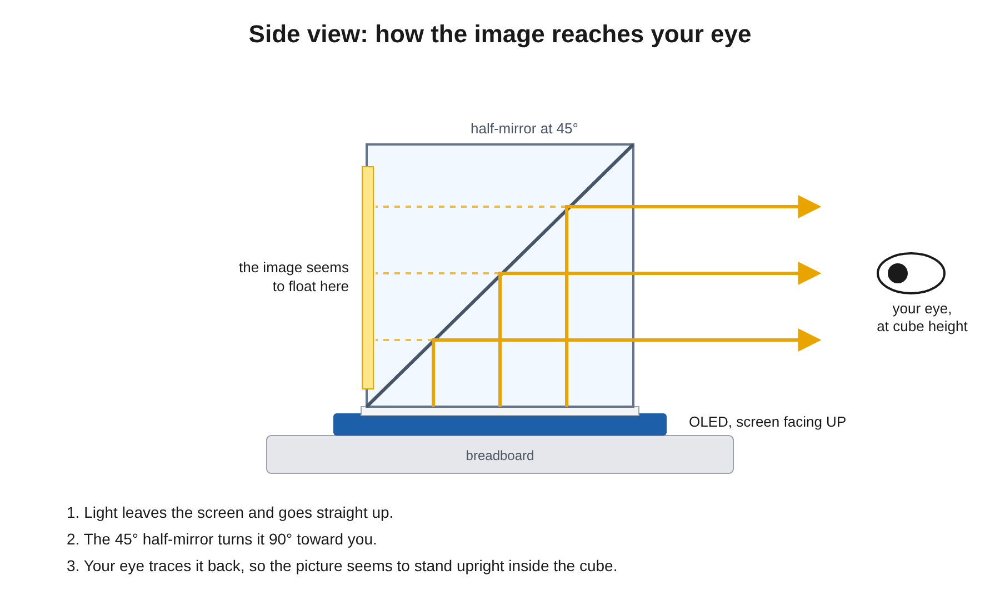
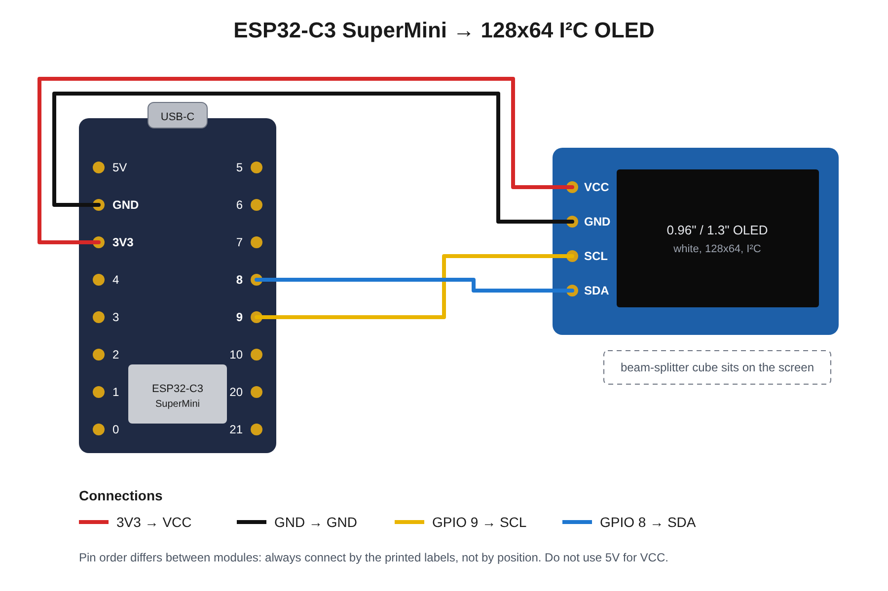

# ESP32 Hologram

An ESP32 drives a small OLED display. A beam-splitting cube sits on top of the display. The cube reflects the image so it looks like it floats inside the glass (a Pepper's ghost effect).

## How it works

The image is not projected onto a wall or screen. It appears inside the cube, and you look straight into one side face.

1. The OLED lies flat with the screen facing up. The cube sits on the screen.
2. A half-mirror runs diagonally through the cube at 45°. It turns the light from the screen 90°, so it comes out of one side face.
3. You see the picture standing upright inside the cube. The mirror is half see-through, so you also see the room behind it, and the picture seems to float.

How to view it:

- Look in at the height of the cube, not down from above.
- Only one side face shows a bright image. Turn the cube on the screen until you find it.
- Use a dim room. Light behind the cube washes out the image.
- If the text is upside down, turn the display (or the whole board) 180°. You do not need to change the code.

## Hardware

- Microcontroller: ESP32 DevKit (classic ESP32)
- Display: 0.96" OLED, 128x64, SSD1306 driver, I²C
- Optics: beam-splitting cube, about 25 mm, placed on the display face

## Choosing an ESP32

- Classic ESP32: best for beginners and most hobby projects. The wiring below is for this board.
- ESP32-S3: use it if you plan to add AI, a camera module or complex media.
- ESP32-C3 / C6: use it for low cost or newer wireless features (the C6 has Wi-Fi 6).

On the S3, C3 and C6 there are no fixed I²C pins. The sketch picks the pins from the board you select in the Arduino IDE: GPIO 21/22 on a classic ESP32, GPIO 8 (SDA) / GPIO 9 (SCL) on the others. Change `SDA_PIN` and `SCL_PIN` if you wire different pins.

## Wiring

Classic ESP32:

| OLED pin | ESP32 pin |
| --- | --- |
| VCC | 3.3V |
| GND | GND |
| SDA | GPIO 21 |
| SCL | GPIO 22 |

ESP32-C3 SuperMini (see the [wiring diagram](wiring-esp32-c3.svg) and the [buy list](BUY-LIST.md)):

| OLED pin | ESP32-C3 pin |
| --- | --- |
| VCC | 3V3 |
| GND | GND |
| SDA | GPIO 8 |
| SCL | GPIO 9 |

On the SuperMini, GPIO 8 also drives the onboard LED and GPIO 9 is the BOOT button. Both work for I²C; the LED may glow faintly while the display runs.

ESP32-S3 (the board in the reference photos):

| OLED pin | ESP32-S3 pin |
| --- | --- |
| VCC | 3.3V |
| GND | GND |
| SDA | GPIO 8 |
| SCL | GPIO 9 |

## Libraries

Install these from the Arduino Library Manager:

- `Adafruit SSD1306`
- `Adafruit GFX Library`
- `Adafruit SH110X` (only for SH1106 displays; set `USE_SH1106` to `1` in the sketch)

## Build and upload

1. In the Arduino IDE, install the ESP32 board package (Boards Manager, search "esp32" by Espressif).
2. Open `hologram/hologram.ino`.
3. Select your board (for example "ESP32 Dev Module") and the serial port.
4. Upload.

If the screen stays blank, change `OLED_ADDR` from `0x3C` to `0x3D`.

## Reference photos

Stills from a reference build (watermark: raspduino), stored in `reference/`.

| Photo | What it shows |
| --- | --- |
| [01-display-side-view.png](reference/01-display-side-view.png) | The OLED lies flat on the breadboard next to the ESP32. The display is off. |
| [02-placing-cube.png](reference/02-placing-cube.png) | The beam-splitting cube is set directly on the display face. |
| [03-hologram-running.png](reference/03-hologram-running.png) | The finished effect: white text and an icon float inside the cube in a dim room. |
| [04-wiring-esp32-s3.png](reference/04-wiring-esp32-s3.png) | Close-up of the wiring: four jumper wires from an ESP32-S3-WROOM-1 to the OLED header. |

What the photos tell us about this build:

- The board is an ESP32-S3 (ESP32-S3-WROOM-1), not a classic ESP32. GPIO 21/22 are not the default I²C pins on the S3. Pick two free GPIOs (for example GPIO 8 = SDA, GPIO 9 = SCL) and the sketch uses these by default on non-classic boards.
- The OLED header is labelled VCC, GND, SCL, SDA, in that order. Some modules use GND, VCC, SCL, SDA. Always read the labels before you connect power.
- The display looks larger than 0.96", probably a 1.3" 128x64 module. Many 1.3" modules use the SH1106 driver, not SSD1306. If the image is shifted by 2 pixels or shows noise at one edge, set `USE_SH1106` to `1` in the sketch and install the `Adafruit SH110X` library.
- In photo 03 the text reads correctly through the cube while the printed pin labels below it appear mirrored. This confirms that the firmware must draw a mirrored image.

## Tips for a good hologram effect

- The cube shows a mirror image. The sketch mirrors everything it draws, so text reads correctly through the glass. Set `MIRROR` to `false` to look at the bare display.
- Keep the background black. Black pixels are invisible in the cube, so only the lit shapes seem to float.
- Use the project in a dim room. The effect is much stronger with little ambient light.
